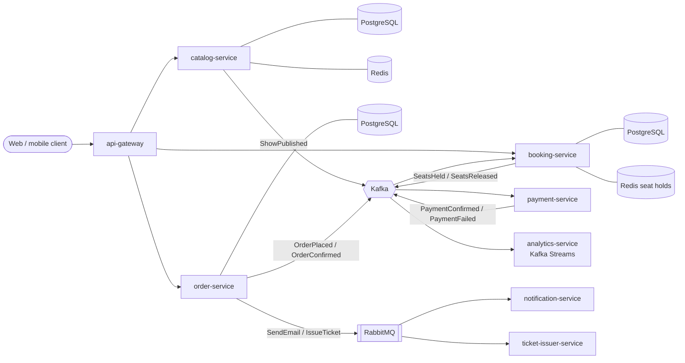

# Future features

Today BoxOffice is one simple, containerized API. This document is the plan for turning it into a full ticketing
platform: one where people browse shows, hold seats, pay and receive their tickets. Each phase builds on the previous
one and adds new skills: testing, Docker, microservices, messaging with Kafka and RabbitMQ, observability and delivery.

Tick the boxes as features land, and keep this file in sync with the code.

## Target architecture

### Services

| Service | Responsibility | Storage | Integration |
|---|---|---|---|
| `catalog-service` | Shows, venues, sessions, price tiers | PostgreSQL, Redis cache | REST; publishes catalog events to Kafka |
| `booking-service` | Seat maps and time-limited seat holds under heavy contention | PostgreSQL, Redis | REST; publishes and consumes seat events |
| `order-service` | Checkout; orchestrates the purchase saga | PostgreSQL | Kafka events, RabbitMQ commands |
| `payment-service` | Talks to a (mocked) payment provider | PostgreSQL | Kafka |
| `notification-service` | E-mail and push notifications | — | RabbitMQ consumer |
| `ticket-issuer-service` | Generates PDF tickets with QR codes | MinIO (S3 compatible) | RabbitMQ work queue |
| `analytics-service` | Live sales per show, occupancy, revenue | Kafka Streams state stores | Kafka |
| `api-gateway` | Single entry point, routing, auth, rate limiting | Redis | HTTP |

### Why both Kafka and RabbitMQ?

They solve different problems, and the platform uses each one where it fits:

- **Kafka carries events**: facts that already happened (`OrderPlaced`, `PaymentConfirmed`). Events go to a durable,
  replayable log that any number of services read independently, at their own pace. Partitioning by `showId` keeps
  the events of one show in order. A new service, like `analytics-service`, can replay the whole history.
- **RabbitMQ carries commands and jobs**: work that exactly one worker must do (`SendEmail`, `IssueTicket`). It gives
  per-message acknowledgements, retries with back-off, dead-letter exchanges, priorities, delayed delivery and flexible
  routing.

## Roadmap

### Phase 0: containerized API (done)

- [x] Spring Boot REST API with `GET /api/v1/shows` returning the shows, earliest first
- [x] Example data in an in-memory H2 database, created by `schema.sql` and seeded by `data.sql` on every startup
- [x] `controller` → `repository` (Spring Data JPA) → `model` (JPA entity) structure
- [x] Multi-stage `Dockerfile` at the project root
- [x] Image built and container run with its port published
- [x] Postman collection

### Phase 1: testing foundation

- [ ] Unit tests with JUnit, Mockito and AssertJ
- [ ] Web slice tests for the controllers with `@WebMvcTest` and `MockMvcTester` (HTTP mapping and JSON contract)
- [ ] Integration tests with `@SpringBootTest` on a random port and `RestTestClient`, run by Maven Failsafe (`*IT`)
- [ ] End-to-end tests in their own `e2e-tests` module: Testcontainers starts the real Docker image and REST Assured
      calls it through the published port
- [ ] JaCoCo coverage report merging unit and integration tests, with a minimum coverage gate (80% lines and branches)
      that fails `mvn verify`
- [ ] Run the Postman collection automatically with Newman

### Phase 2: a complete catalog API

- [ ] `GET /api/v1/shows/{id}`
- [ ] Error responses as RFC 9457 problem details (`application/problem+json`), e.g. `404` for an unknown show
- [ ] A service layer for the use cases, and response DTOs so the JPA entity is no longer returned directly as JSON
- [ ] H2 console to browse the example data during development
- [ ] Domain validation (required fields, a category enum, a `Currency` type)
- [ ] Spring Boot Actuator: health, liveness and readiness probes, build info
- [ ] OpenAPI documentation and Swagger UI (springdoc)

### Phase 3: a production-grade Docker image

- [ ] Run as a non-root user
- [ ] `HEALTHCHECK` on the readiness probe, so `docker ps` shows `(healthy)`
- [ ] Spring Boot layered jar, so a code change only rebuilds the thin top layer
- [ ] BuildKit cache mount for `~/.m2`, so dependencies are downloaded once across builds
- [ ] Container-aware JVM settings (`-XX:MaxRAMPercentage`)
- [ ] Smaller image: custom runtime with `jlink`, or a distroless base

### Phase 4: ready for many services

- [ ] Maven multi-module project: a parent POM with shared versions, test plugins and the coverage gate, and one module
      per service
- [ ] One root Dockerfile for every service, choosing the module with a `SERVICE` build argument
- [ ] `docker-compose.yml` that starts the whole local stack

### Phase 5: a real catalog

- [ ] PostgreSQL instead of the in-memory H2 database (`ShowRepository` and the entities stay the same)
- [ ] Flyway migrations replacing `schema.sql`, with the example data moved to a dev-only migration
- [ ] Venues, sessions and price tiers; pagination, filtering (city, category, date range) and sorting
- [ ] Write endpoints (admin) with Bean Validation
- [ ] Redis caching for catalog reads
- [ ] Testcontainers PostgreSQL integration tests and `@DataJpaTest` repository slices
- [ ] ArchUnit tests that enforce the layer rules

### Phase 6: booking under contention

- [ ] `booking-service` with seat maps per session
- [ ] Seat holds that expire (Redis TTL), released automatically
- [ ] Optimistic locking and idempotency keys so the same seat is never sold twice
- [ ] Concurrency tests that simulate a "flash sale" with thousands of parallel hold attempts

### Phase 7: event backbone with Kafka

- [ ] Domain events: `ShowPublished`, `ShowRescheduled`, `SeatsHeld`, `SeatsReleased`, `OrderPlaced`, ...
- [ ] Transactional outbox pattern, so database writes and published events never diverge
- [ ] Idempotent consumers (processed-message table) and per-key ordering
- [ ] Retry topics and dead-letter topics (`@RetryableTopic`)
- [ ] Schema Registry with Avro and compatibility checks
- [ ] `analytics-service` with Kafka Streams: tickets sold per show and occupancy, in real time
- [ ] Testcontainers Kafka integration tests

### Phase 8: commands and jobs with RabbitMQ

- [ ] `notification-service` consuming `SendEmail` / `SendPush` commands (Mailpit for local e-mail)
- [ ] `ticket-issuer-service` as a work queue that generates PDF tickets with QR codes and stores them in MinIO
- [ ] Retries with back-off, dead-letter exchanges and parking-lot queues
- [ ] Delayed messages (for example "your seat hold expires in 2 minutes")
- [ ] Publisher confirms and manual acknowledgements
- [ ] Testcontainers RabbitMQ integration tests

### Phase 9: distributed transactions

- [ ] `order-service` and `payment-service`
- [ ] Orchestrated saga for checkout: hold seats → pay → confirm order → issue ticket
- [ ] Compensating actions: release seats when payment fails or times out
- [ ] Payment provider simulated with WireMock, including slow and failing responses

### Phase 10: edge and security

- [ ] `api-gateway` with Spring Cloud Gateway
- [ ] Keycloak as identity provider (OAuth 2.1 / OpenID Connect)
- [ ] Services as JWT resource servers, with role-based access for admin endpoints
- [ ] Rate limiting per client at the gateway; CORS policy

### Phase 11: resilience

- [ ] Resilience4j circuit breakers, retries, timeouts and bulkheads on synchronous calls
- [ ] Graceful degradation (catalog served from cache when the database is down)
- [ ] Failure-injection tests with Toxiproxy (Testcontainers)

### Phase 12: observability

- [ ] Metrics with Micrometer, Prometheus and Grafana dashboards
- [ ] Distributed tracing with OpenTelemetry across HTTP, Kafka and RabbitMQ (Grafana Tempo or Jaeger)
- [ ] Structured JSON logs with trace and correlation ids, centralized in Loki
- [ ] Business metrics: tickets sold, hold expirations, payment failures

### Phase 13: advanced testing

- [ ] Consumer-driven contract tests between services (Spring Cloud Contract or Pact)
- [ ] Full-system E2E tests against the Docker Compose stack (a complete purchase, end to end)
- [ ] Aggregated JaCoCo report across all modules
- [ ] Coverage of code running inside containers during E2E tests (JaCoCo agent in the image + `jacoco:dump`)
- [ ] Mutation testing with PIT
- [ ] Load tests of the flash-sale scenario with Gatling or k6

### Phase 14: delivery

- [ ] GitHub Actions: build, tests, coverage gate, image build, E2E tests and publishing to GitHub Container Registry
- [ ] Image vulnerability scanning (Trivy) and an SBOM for each image
- [ ] Static analysis and quality gate (SonarCloud); code formatting (Spotless)
- [ ] Dependency updates with Dependabot or Renovate
- [ ] Kubernetes manifests with Helm charts, probes, resource limits and autoscaling (tested locally with kind or k3d)
- [ ] GitOps deployment with Argo CD

## Technical backlog

- [ ] Upgrade to Java 25 (LTS)
- [ ] Virtual threads for request handling (`spring.threads.virtual.enabled`)
- [ ] Faster startup: AOT cache / Class Data Sharing, or GraalVM native images
